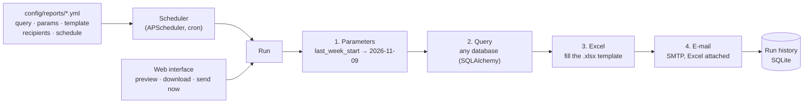

# SQL Report Scheduler


A small **open-source report scheduler**: it runs a SQL query on any database, fills a **predefined Excel template** with the result and **e-mails it on a schedule** ("every Monday at 8:00", "the first day of the month"). Each report is one YAML file, so adding one needs no code.

It covers the core job of enterprise reporting tools such as SSRS subscriptions, in a few hundred lines of readable Python.

> Independent personal project. The demo store and all its data are synthetic.

---

## The business problem

In many companies someone runs the same query every week, pastes the result into an Excel file, fixes the formatting and e-mails it to the same people. It is repetitive, it depends on one person being there, and a forgotten step means a wrong or missing report.

Enterprise tools solve this, but they need licences, servers and specialists. Business users often just want **their usual Excel file, with their formatting, in their inbox on time**.

**Goal:** describe a report once (query, template, recipients, schedule) and let the scheduler deliver it, with a history of every run.

Requirements and acceptance criteria: [docs/requirements.md](docs/requirements.md).

## How it works



1. **Parameters.** Relative dates such as `last_week_start` or `last_month_end` are computed from the day the report runs.
2. **Query.** The SQL runs through SQLAlchemy, so the same code works with SQL Server, PostgreSQL, MySQL, SQLite or DuckDB. Parameters are **bound by the driver**, never pasted into the SQL text, which prevents SQL injection.
3. **Excel.** The template is a normal `.xlsx` prepared in Excel. The scheduler writes the data under the header row, copies the format of the first data row (number formats, borders), adds a total row with `SUM` formulas and fills placeholders such as `{{ title }}` or `{{ start_date }}`.
4. **E-mail.** The file is attached to an e-mail whose subject and body can use the same placeholders.
5. **History.** Every run is recorded: when, by whom (schedule or manual), how many rows, to whom it was sent, and the error if it failed. Temporary problems, such as the database or mail server being unreachable, are retried twice.

## A report is one file

```yaml
# config/reports/weekly_sales_by_category.yml
title: Weekly sales by category
connection: demo_shop
schedule: "0 8 * * 1"            # every Monday at 8:00 (standard cron)

params:
  start_date: last_week_start    # Monday of last week
  end_date: last_week_end        # Sunday of last week

query: |
  select p.category, count(distinct o.order_id) as orders, ...
  where o.order_date between :start_date and :end_date
  group by p.category

template: templates/weekly_sales.xlsx
total_columns: [orders, units, revenue]

email:
  to: [sales-team@example.com]
  subject: "Weekly sales by category {{ start_date }} - {{ end_date }}"
  body: |
    Hello, please find attached the sales from {{ start_date }} to {{ end_date }}.
```

Every file is checked when it is loaded: required fields, a single `SELECT` statement, parameters actually used in the query, a valid schedule, an existing template.

| Relative date | Meaning |
|---|---|
| `today`, `yesterday` | |
| `week_start` | Monday of this week |
| `last_week_start`, `last_week_end` | Monday and Sunday of last week |
| `month_start` | first day of this month |
| `last_month_start`, `last_month_end` | first and last day of last month |
| `year_start` | 1 January of this year |

## Quick start

Requirements: Docker Desktop.

```bash
git clone https://github.com/ang-ai-tech/sql-report-scheduler.git
cd sql-report-scheduler
docker compose up --build
```

| Address | What |
|---|---|
| <http://localhost:8505> | Web interface: reports, data preview, download, send now, history |
| <http://localhost:8025> | **Mailpit**, a fake mail server: every e-mail sent by the demo arrives here, with its Excel attachment |

The demo creates a small database of a fictional online store and starts the scheduler with `--run-now`, so the three sample reports arrive in Mailpit within a few seconds. After that they follow their schedule.

### Command line

```bash
pip install -e ".[ui,dev]"
reports demo                                   # demo database + Excel templates
reports list                                   # reports and next scheduled run
reports preview weekly_sales_by_category       # the data, nothing else
reports run weekly_sales_by_category --no-email
reports run weekly_sales_by_category --date 2026-10-05   # as if today were 5 October
reports schedule                               # keep running and send on schedule
reports history
streamlit run app.py
```

### Use your own database and mail server

1. Add the connection to `config/connections.yml`, with `${VARIABLES}` for user names and passwords, and install the driver (`pip install -e ".[sqlserver]"`, `".[postgres]"` or `".[duckdb]"`). Use a database account with **read-only** permissions.
2. Copy `.env.example` to `.env` and set the SMTP server and the database credentials.
3. Prepare an Excel template: title area at the top, column headers in row 5, the first data row (row 6) formatted as you want the data to look.
4. Add a YAML file in `config/reports/`.

## Sample reports

| Report | Schedule | Content |
|---|---|---|
| `weekly_sales_by_category` | Mondays 8:00 | Orders, units and revenue of last week by category, with totals |
| `monthly_country_summary` | 1st of the month 7:00 | Customers, orders, revenue and average order of last month by country |
| `daily_cancelled_orders` | Monday–Friday 9:00 | Yesterday's cancelled and refunded orders, for customer service |

## Key design decisions

| Decision | Why | ADR |
|---|---|---|
| One YAML file per report, Excel templates made in Excel | Business users can read and change reports; formatting stays in Excel | [0001](docs/decisions/0001-reports-as-files.md) |
| SQLAlchemy with bound parameters, read-only queries | Any database, no SQL injection, a report can only read data | [0002](docs/decisions/0002-any-database-safe-queries.md) |
| APScheduler in one process, standard cron syntax, Mailpit for tests | Simple to run and to explain; e-mails can be tested without sending any | [0003](docs/decisions/0003-scheduling-and-email.md) |

## Project structure

```
├── config/
│   ├── connections.yml        # databases, by name
│   └── reports/*.yml          # one file per report
├── templates/*.xlsx           # Excel templates
├── src/reportsched/
│   ├── config.py              # load and check the configuration, cron syntax
│   ├── params.py              # relative dates and {{ placeholders }}
│   ├── query.py               # run the SQL with bound parameters
│   ├── excel.py               # fill the template
│   ├── mailer.py              # SMTP
│   ├── runner.py              # one run, with retries and history
│   ├── history.py             # run history (SQLite)
│   ├── scheduler.py           # APScheduler jobs
│   ├── demo.py                # demo database and templates
│   └── cli.py                 # `reports ...`
├── app.py                     # Streamlit web interface
├── tests/                     # pytest
└── docs/                      # requirements, architecture, decisions (ADR)
```

## Limitations & next steps

- One scheduler process; for high availability the job store could move to a shared database (APScheduler supports it).
- Reports are edited as files; there is no editor in the web interface and no user login.
- The Excel template is filled from one fixed row; multi-sheet reports or pivot tables would need more template options.
- Possible extensions: PDF and CSV output, delivery to Teams or a shared folder, a report only when there is data (e.g. no e-mail if there are no cancelled orders), parameters chosen by the recipient.

## License

[MIT](LICENSE)
