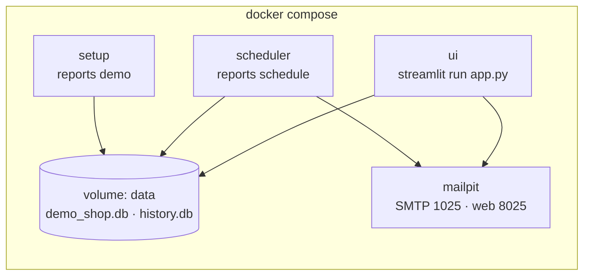

# Architecture

## Processes



| Service | Role |
|---|---|
| `setup` | Creates the demo database (orders up to yesterday) and exits |
| `scheduler` | Long-running process: APScheduler starts each report at its cron time |
| `ui` | Streamlit web interface; "send now" runs a report in the same way as the scheduler |
| `mailpit` | Fake SMTP server that keeps every e-mail and shows it in a web inbox |

The scheduler and the web interface share the run history (a SQLite file) and the generated reports through Docker volumes.

## One run

`runner.run_report()` does the same steps for a scheduled run, a command-line run and the "send now" button:

1. **Resolve parameters** (`params.resolve`): relative dates from the run date.
2. **Query** (`query.run_query`): SQLAlchemy `text()` with bound parameters; date parameters are typed as `Date` so every database receives a real date.
3. **Excel** (`excel.fill_template`): load the template with openpyxl, check that the number of header columns matches the query, write the rows copying the style of the first data row, add the total row with `SUM` formulas, replace `{{ placeholders }}` in every sheet, save to `output/<report>/<report>_<date>.xlsx`.
4. **E-mail** (`mailer`): `EmailMessage` with the attachment, sent with `smtplib` (STARTTLS and login if configured).
5. **History** (`history`): one row per run, from `running` to `success` or `failed`.

Errors are split in two groups:

| Error | Examples | Behaviour |
|---|---|---|
| Temporary | database unreachable, mail server disconnected, timeout | retried twice, 60 seconds apart |
| Permanent | SQL error, template does not match, missing column | not retried: recorded as failed at once |

`run_report` never raises, so one failing report never stops the scheduler.

## Scheduling

APScheduler's `BlockingScheduler` keeps one job per report:

- `coalesce=True`: if several runs were missed (scheduler stopped), run once, not many times;
- `misfire_grace_time=3600`: a run missed by less than an hour still happens;
- `max_instances=1`: the same report never runs twice at the same time.

Schedules use standard 5-field cron syntax. APScheduler counts days of the week from Monday = 0, while standard cron uses Sunday = 0 and Monday = 1. `config.cron_trigger()` converts day numbers to names first (`1-5` → `mon-fri`), so `0 8 * * 1` means Monday as everyone expects. A test checks it.

## Excel templates

```
Row 1   {{ title }}
Row 2   Period: {{ start_date }} - {{ end_date }}
Row 3   Generated on {{ generated_at }} · {{ rows }} rows
Row 5   Category | Orders | Units | Revenue        ← header_row
Row 6   (formatted as the data should look)        ← data starts here
```

Placeholders: `title`, `report`, `run_date`, `generated_at`, `rows` and every parameter of the report. Dates are shown as `dd/mm/yyyy`.
